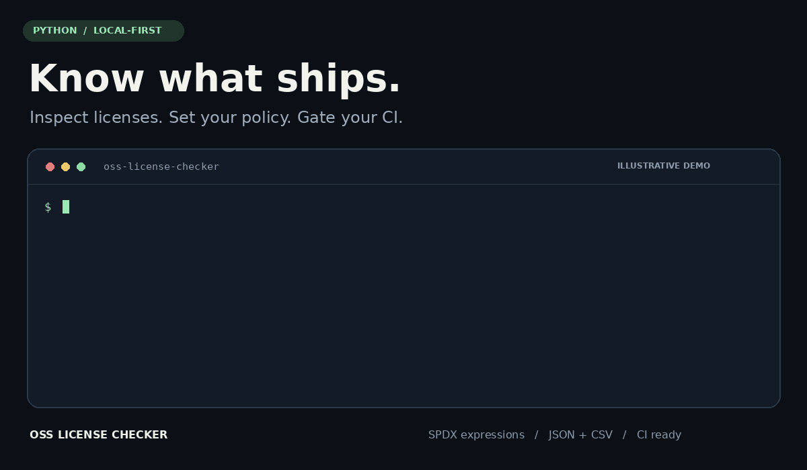
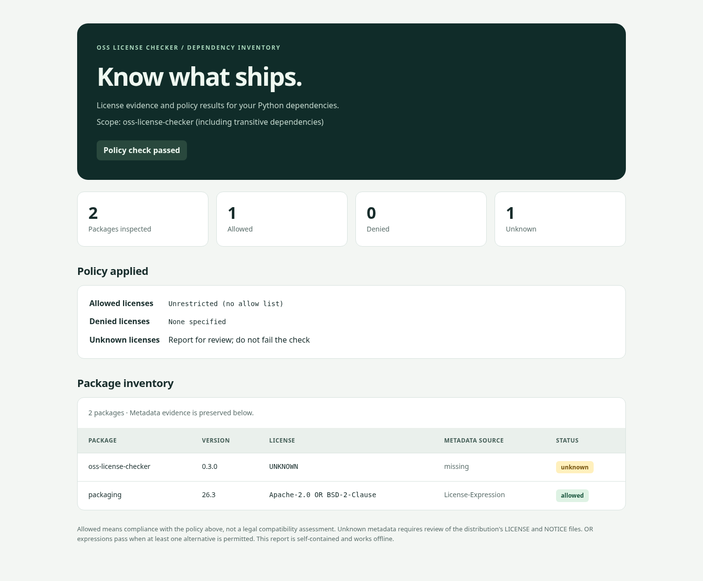

# oss-license-checker



[](https://github.com/rsasaki0109/oss_license_checker/actions/workflows/test.yml)


**Know what ships.** 依存ライセンスの可視化から、リリース前のポリシー検査まで。

初回リリースに向けて導入体験を確認中です。[検証済みの範囲と残作業](docs/RELEASE_CANDIDATE.md) · [変更履歴](CHANGELOG.md)

Python環境にインストールされたパッケージのライセンスを一覧化し、CIで許可・禁止ルールを検査するCLIです。Python 3.11以上。パッケージのコードは実行せず、ローカルの配布メタデータを読み取ります。依存指定の解析には `packaging` を使用します。

## 最初の検査まで

Python 3.11以上とGitを用意してください。Linux・macOSでは、次の手順でRequestsとその依存を試せます。`python` コマンドがない環境では、最初の `python -m venv` を `python3 -m venv` に置き換えます。インストール時はネットワーク接続が必要です。

```bash
git clone https://github.com/rsasaki0109/oss_license_checker.git
cd oss_license_checker
python -m venv .venv
source .venv/bin/activate
python -m pip install . requests
oss-license-checker requests --recursive \
  --config examples/validation/requests/policy.toml \
  --format html --output licenses.html
```

終了コード0で、今いるフォルダに `licenses.html` が生成されれば検査完了です。macOSでは `open licenses.html`、Linuxのデスクトップ環境では `xdg-open licenses.html` で開けます。画面上部の判定、Unknown件数、各パッケージの結果を確認してください。検証用ポリシーは設定例なので、自分のプロジェクトでは必要なライセンス条件を確認して調整します。

[実プロジェクト3件の検証結果と再現手順](docs/VALIDATION.md) · [導入手順の確認結果](docs/ONBOARDING.md) · [リリース手順](docs/RELEASING.md) · [MIT License](LICENSE)

## 自分のプロジェクトで使う

検査したいプロジェクトのフォルダへ移動し、そのプロジェクト用の仮想環境を有効にします。本ツールは、実行したPython環境にインストール済みのパッケージを検査します。別の仮想環境や、フォルダ内のソースを自動で検査するものではありません。

パッケージとしてインストールできるプロジェクトなら、次のように導入できます。PyPIには未公開なので、ここではGitから本ツールをインストールします。

```bash
# 自分のプロジェクトのフォルダで実行
python -m pip install . 'git+https://github.com/rsasaki0109/oss_license_checker.git'
```

`pyproject.toml` の `[project].name` を次の `your-package` に置き換えます。フォルダ名やPythonのimport名と異なる場合があります。

```bash
oss-license-checker your-package --recursive --format html --output licenses.html
```

`requirements.txt` で管理し、自分のコードをパッケージとしてインストールしないアプリなら、環境全体を検査できます。

```bash
python -m pip install -r requirements.txt 'git+https://github.com/rsasaki0109/oss_license_checker.git'
oss-license-checker --format html --output licenses.html
```

引数なしでは本ツールや開発用ツールも対象に含みます。ポリシーなしの最初の実行は一覧の確認用です。CIで違反・不明を検出するには、次の「ポリシーを保存」でルールを設定して `--config` を指定してください。本番で使うGitインストール先は、確認したコミットSHAに固定できます。

## 出力とインストールの確認

```bash
oss-license-checker --version
oss-license-checker
oss-license-checker --format json
oss-license-checker --format csv --output licenses.csv
oss-license-checker --format html --output licenses.html
```

対象プロジェクトの仮想環境に依存パッケージと本ツールをインストールして実行してください。引数なしでは、その環境の全パッケージ（推移依存、開発用ツール、本ツール自身を含む）を検査します。名前だけ指定した場合は指定パッケージのみ検査します。

## プロジェクトの推移依存を検査

```bash
oss-license-checker requests --recursive --format json
oss-license-checker 'httpx[http2]' --recursive --fail-unknown
```

`--recursive` はルートパッケージと、その `Requires-Dist` を再帰的に検査します。現在のPython・OSに適用される環境マーカーと、明示したextrasを評価します。循環依存でも停止します。未インストールの依存、バージョン条件の不一致、不明なextrasは終了コード2で報告します。レジストリへの問い合わせや自動インストールは行いません。直接URLの依存は名前で照合し、インストール元URLの一致は検証しません。

extrasの例を使う前には `python -m pip install 'httpx[http2]'` で対象の依存もインストールします。

## ポリシーを保存

`pyproject.toml` に以下を追加できます。

```toml
[tool.oss-license-checker]
allow = ["MIT", "Apache-2.0", "BSD-3-Clause"]
deny = ["GPL-3.0-only"]
fail-unknown = true
```

```bash
oss-license-checker your-package --recursive --config pyproject.toml
```

専用のTOMLファイルではテーブル見出しを省略し、同じ3つのキーをトップレベルに置きます。設定は `--config` で明示した場合のみ読み込みます。CLIの `--allow` / `--deny` は対応する設定リストを置き換えます。`--fail-unknown` / `--no-fail-unknown` で設定値を上書きできます。未知のキーや型の誤りは終了コード2になります。

### 確認済みライセンスをパッケージ単位で設定（v0.6.0以降）

メタデータにライセンスがない場合など、配布物のLICENSEを確認した結果を記録できます。以下は架空のパッケージに対する設定例です。

```toml
[tool.oss-license-checker.overrides."legacy-package"]
license = "MIT"
version = "1.2.3"
reason = "1.2.3の配布物のLICENSEを確認。レビュー記録: LEGAL-123"
```

専用のTOMLでは `[overrides."legacy-package"]` にします。`license`・`version`・`reason` はすべて必須です。`license` は有効なSPDX式、`version` は確認した単一のバージョン、`reason` は確認の根拠を記載します。パッケージ名は正規化して照合します。

- 検査対象のバージョンが変わると、再確認が必要な設定エラー（終了コード2）にします。バージョン範囲やワイルドカードは指定できません。
- 設定したライセンスを通常の許可・禁止ルールで判定します。ライセンスの補正だけでは自動的に許可しません。独自の `LicenseRef-` も明示的なルールが必要です。
- `license` / `source` には元のメタデータを残し、判定に使った値を `effective_license`、確認の根拠を `override_reason` として全形式で出力します。HTMLでも元の値と補正後の値を並べて表示します。
- 差分検査は `effective_license` の変更も検出します。確認理由の文章だけの変更は差分にしません。v0.5.0以前のJSONも引き続き基準に使えます。
- 検査対象外のパッケージには適用しません。設定の構文・ライセンス名・バージョン・キーの誤りは、対象外でも検出します。

## CIでの利用

```bash
oss-license-checker --allow MIT --allow Apache-2.0 --allow BSD-3-Clause \
  --deny GPL-3.0-only --fail-unknown --format json --output licenses.json
```

- `--allow` / `--deny` は繰り返し指定できます。SPDXの公式識別子は大文字小文字を正規化します。例えば `--allow mit` は `MIT` として判定します。各指定には単一ライセンス、または `Apache-2.0 WITH LLVM-exception` のような例外付きライセンスを指定します。`AND` / `OR` 式はパッケージ側のメタデータでのみ扱います。
- 許可リストを指定すると、リスト外のライセンスは拒否されます。禁止指定は許可指定より優先します。
- `AND` は両方の許可、`OR` はいずれかの許可が必要です。例えば `MIT OR GPL-3.0-only` はMITが許可されていれば通ります。禁止指定はOR式全体の無条件拒否を意味しません。
- 括弧と `WITH` に対応します。例外付きライセンスを許可するには `--allow 'Apache-2.0 WITH LLVM-exception'` のように全体を指定してください。基底ライセンスの禁止は例外付きにも適用します。
- `--fail-unknown` は不明なライセンスもCIエラーにします。

終了コード: `0` = 検査通過、`1` = ルール違反・不明（`--fail-unknown`時）・変更（`--fail-on-change`時）・証拠ファイル欠落（`--fail-missing-license-files`時）、`2` = 設定・未インストールのパッケージ・ファイル出力などの実行エラー。

### 結果を見て次にすること

| 結果・症状 | 確認・対応 |
| --- | --- |
| `denied` / 終了コード1 | ライセンスとポリシーを確認。必要な利用条件を満たせるか検討し、ルールを変更する場合は根拠を残します。 |
| `unknown` | `reason` と配布物のLICENSE・NOTICEを確認。「確認済みライセンス」の設定でバージョン・根拠を記録できます。 |
| `Package is not installed` / 終了コード2 | 仮想環境とパッケージ名を確認し、同じPythonの `python -m pip show your-package` で調べます。 |
| 設定ファイルが見つからない | `--config` は現在のフォルダを基準に読みます。設定は自動検出しません。 |
| CLIが見つからない | 対象の仮想環境を有効にするか、そのPythonで `python -m oss_license_checker --version` を試します。 |
| 終了コード1なのにレポートがある | 失敗結果の確認用に保存する仕様です。終了コード2の場合は生成されないことがあります。 |

## 共有用HTMLレポート



```bash
oss-license-checker your-package --recursive --config pyproject.toml \
  --format html --output licenses.html
```

`licenses.html` をブラウザで開くと、検査の成否、許可・拒否・不明の件数、適用したポリシー、各パッケージのライセンスと取得元を確認できます。CSSを内蔵した単一ファイルで、JavaScriptや外部通信は不要です。画面幅に合わせて表示し、印刷にも対応しています。

違反で終了コード1になった場合もレポートは出力します。CIでは出力ファイルをartifactとして保存すると、結果をチームで共有できます。設定の `fail-unknown` がfalseでCLIからも有効にしていなければ、不明ライセンスがあってもチェックは通ります。本リポジトリのGitHub ActionsもHTMLレポートをartifactとして保存します。

## GitHub Actionとして使う

```yaml
steps:
  - uses: actions/checkout@v4
  - uses: actions/setup-python@v5
    with:
      python-version: '3.12'
  - run: python -m pip install .
  - uses: rsasaki0109/oss_license_checker@main
    with:
      packages: your-package
      recursive: 'true'
      config: pyproject.toml
      artifact-name: dependency-licenses
```

Linux・macOSのbash環境とPython 3.11以上を対象とするcomposite actionです。本番では `@main` をレビュー済みコミットSHAに固定してください。検査したい依存は事前にインストールします。Actionは指定したPython環境に本ツールと必要な `packaging` をインストールするため、環境全体の検査にはこれらも含まれます。`packages` と `recursive` で対象を絞れます。

- `python`：実行するPythonのパス（既定 `python`）。仮想環境を使う場合はそのPythonを指定します。
- `packages`：インストール済みのルート名を1行に1つ指定します。空なら全環境。extrasも指定できます。`recursive` は既定 `false`。
- `config` / `baseline`：呼び出し元の作業ディレクトリを基準とする設定・基準JSONパス。
- `fail-unknown`：`inherit`（既定、設定ファイルに従う）・`true`・`false`。
- `fail-on-change` / `fail-missing-license-files`：既定 `false`。CLIと同じ終了条件です。
- `output-directory`：出力先の親ディレクトリ。既定 `license-reports`。実行ごとに固有のサブディレクトリを作ります。
- `upload-artifact`：既定 `true`。MarkdownとLICENSE・NOTICEのZIPを保存します。matrixでは `artifact-name` をジョブごとに変えてください（既定 `license-report`）。

Job Summaryに結果を掲載し、違反時もartifactを保存した後でステップを失敗させます。実行エラーではレポートが作られない場合があります。outputsは `report-path`・`bundle-path`（絶対パス）と `exit-code`（0 / 1 / 2）です。アップロードにはGitHub Actionsのartifactサービスを使います。ソースコードはartifactに含めません。

## MarkdownとGitHub Actions Job Summary

```bash
oss-license-checker your-package --recursive --config pyproject.toml \
  --format markdown --output licenses.md
```

Markdownレポートには件数、判定、適用ポリシー、各パッケージの元のライセンス・判定に使った値・確認理由を含みます。`--baseline` と組み合わせると変更前後の差分も表示します。メタデータ中のMarkdown記号やHTMLは文字として出力します。

GitHub Actionsでは次のステップで結果をJob Summaryに表示できます。違反時もレポートを掲載し、CLIの終了コードをそのまま返します。

```yaml
- name: Check dependency licenses
  shell: bash
  run: |
    check_status=0
    oss-license-checker your-package --recursive --config pyproject.toml \
      --format markdown --output licenses.md || check_status=$?
    if [ -f licenses.md ]; then
      cat licenses.md >> "$GITHUB_STEP_SUMMARY"
    fi
    exit "$check_status"
```

本リポジトリのCIもJob SummaryとartifactにMarkdownを保存します。CLI自体はGitHubへの投稿やコメント送信を行いません。

## LICENSE・NOTICEの収集

```bash
oss-license-checker your-package --recursive --config pyproject.toml \
  --license-bundle third-party-licenses.zip --format html --output licenses.html

# ファイルが見つからないパッケージもCIエラーにする
oss-license-checker your-package --recursive \
  --license-bundle third-party-licenses.zip --fail-missing-license-files
```

インストール済みの配布物のファイル一覧を使って、LICENSE / LICENCE / COPYING / NOTICE / COPYRIGHTとその拡張子・接尾辞付きファイルを収集します。PEP 639の `.dist-info/licenses/` 以下のファイルと、メタデータの `License-File` に対応するファイルも対象です。推移依存の選択やライセンス補正設定と併用できます。

ZIPには以下を含みます。

- 元のバイト列を保持した証拠ファイル（パッケージ名・バージョンごとのフォルダ）
- `manifest.json`：検査結果、取得元とZIP内パス、SHA-256、バイト数、未検出の宣言ファイル
- 各パッケージの `evidence_status`：ファイルがあり宣言されたファイルも揃っていれば `collected`、それ以外は `missing`

通常はファイル欠落をmanifestと標準エラーに記録します。`--fail-missing-license-files` を付けると、収集対象ファイルが1つもないパッケージ、または宣言されたファイルの欠落があれば終了コード1です。NOTICEだけが見つかった場合も収集済みとして扱うため、必要なLICENSE本文が揃っているかは別途確認してください。ライセンスルール違反で終了コード1の場合もZIPは保存します。

読めないファイルや不正なパスは終了コード2です。ZIPは完成後に保存し、収集エラー時は既存のZIPを保持します。ZIP出力先とレポート・設定・基準ファイルは別パスにしてください。ファイル一覧を持たない配布物やeditable installでは検出できないことがあります。ローカルのファイルシステム上の配布物を対象とし、レジストリへの問い合わせやソースコード全体の探索は行いません。この収集結果だけで配布義務の充足を判断するものではありません。本リポジトリのGitHub ActionsでもHTMLとZIPをartifactとして保存します。

## 前回の結果との差分（v0.5.0以降）

同じ対象・環境・ポリシーで取得したJSONを基準として保存します。

```bash
oss-license-checker your-package --recursive --config pyproject.toml \
  --format json --output baseline.json

# 依存を更新した後、基準との差分を確認
oss-license-checker your-package --recursive --config pyproject.toml \
  --baseline baseline.json --format html --output changes.html

# 変更があればCIを止め、JSONでレビュー用の差分を保存
oss-license-checker your-package --recursive --config pyproject.toml \
  --baseline baseline.json --fail-on-change --format json --output changes.json
```

- `added` / `removed` / `changed` を検出し、変更前後の値と変更フィールドを表示します。名前は `-` / `_` / `.` と大文字小文字を正規化して照合します。
- バージョン、ライセンスの元表記、判定に使った `effective_license`、メタデータ取得元、判定ステータスを比較します。説明文の `reason` / `override_reason` は比較しません。表記だけのライセンス変更もレビュー対象になります。
- 差分モードのJSONは `{"packages": [...], "changes": [...]}` です。`packages` は現在の全検査結果、`changes` は差分です。通常のJSON一覧と、前回の差分JSONのどちらも基準にできます。追加は `before: null`、削除は `after: null` になります。
- ターミナルとCSVは差分のみを表示します。HTMLは差分と現在の全一覧を表示します。削除だけの場合も差分に含みます。
- 通常は変更を報告するだけです。`--fail-on-change` を追加すると、どの比較フィールドの変更・追加・削除でも終了コード1になります。レポートは失敗時も保存します。
- 以前の検査結果を許可として流用せず、現在の全パッケージを現在のポリシーで再判定します。差分がなくても既存の禁止ライセンスは失敗します。
- 壊れた基準ファイル、名前の重複、基準と出力への同じパス指定は終了コード2です。対象範囲やOS・Python・ポリシーの違いも差分になるため、比較条件を揃えてください。基準ファイルの自動更新は行いません。

## 判定の範囲

`License-Expression` を優先し、次に古い `License`、ライセンス関連の `Classifier` を証拠として記録します。古い `License` も公式SPDX識別子・式として検証できれば判定します。自由文とClassifierは不明として扱います。ライセンス本文の同定、法的な互換性判定、NOTICEの作成は行いません。`allowed` は指定ポリシーに適合する意味です。

### SPDX識別子の検証（v0.4.0以降）

`packaging>=24.2` に同梱されたSPDX一覧を使い、ライセンス名・例外名・式の構文を検証します。実行時のネットワークアクセスはありません。一覧の更新は `packaging` の更新に従います。

- 存在しない識別子や例外名は `unknown` です。`--fail-unknown` を付けると終了コード1になります。例: `MIT WITH MadeUp-exception`。
- 不正な式の一部に許可済みライセンスがあっても、式全体を不明として扱います。
- `LicenseRef-Internal` などの独自ライセンスは、内容を確認したうえで同じ識別子を許可・禁止リストに明記した場合のみ判定します。独自の接尾辞は大文字小文字を区別します。
- 設定の識別子の誤記や、`--allow 'MIT OR Apache-2.0'` のような複合指定は設定エラー（終了コード2）です。識別子を繰り返し指定してください。
- 出力に `reason` を追加しました。JSON・CSV・HTML・ターミナル出力で、許可・拒否・不明の理由を確認できます。元のメタデータ表記は `license` に保持します。

ポリシー未指定時は、公式識別子で構成された有効な式を許可します。不明なメタデータもCIで検出したい場合は `--fail-unknown` を指定してください。

メタデータが欠落・不正確な場合もあるため、配布物のLICENSE/NOTICEや利用条件の確認には別途レビューが必要です。CSVにはメタデータをそのまま出力するため、信頼できない依存パッケージのレポートを表計算ソフトで開く場合は文字列として取り込んでください。

## 開発

```bash
python -m pip install -e .
python -m unittest discover -s tests -v
```

`python -m oss_license_checker` でも同じCLIを実行できます。

### 配布物のビルド

```bash
python -m pip install build twine
python -m build
python -m twine check dist/*
```

`dist/` にwheelとソース配布物を作成します。GitHub Actionsの `distribution` ワークフローでもビルドし、ソース配布物からwheelを生成したうえで、独立した仮想環境へインストールしてCLIを確認します。成果物は `python-distributions` artifactから取得できます。PyPIへの公開やリリース作成は自動では行いません。

READMEのGIFは架空のパッケージメタデータに対する実際のCLI判定を使ったデモです。開発用にPillowをインストールし、`python scripts/render_hero.py` で再生成できます（DejaVuフォントが必要）。PillowはCLIの実行依存には含みません。
